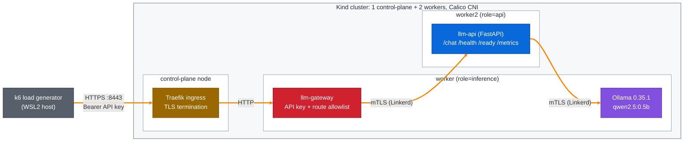

# Secure LLM Serving on Kubernetes

[](https://github.com/farrukhshafique87/secure-llm-serving-kubernetes/actions/workflows/ci.yml)
[](LICENSE)

Measures the latency and resource cost of RBAC, NetworkPolicies, Linkerd mTLS, TLS and an
API-key gateway for an LLM service (FastAPI + Ollama) on Kubernetes.

Built as part of my M.Sc. thesis in Information Technology at Frankfurt University of
Applied Sciences.

## Key findings (Kind, EXP-06, 3 repetitions per configuration)

- With **all controls enabled**, the lightweight `/health` path became **+4.99 ms slower
  (+256.7 %)**: 6.94 ms instead of 1.95 ms on average.
- On the inference path `/chat` (about 2.1 s per request), **no control made requests
  measurably slower**: the differences stayed within run-to-run drift.
- On the `/health` path at 50 requests/s, the full security stack used **+279 millicores CPU
  and +264 MiB memory** across the pods in the request path. The gateway alone added the
  most CPU (+134 m), Linkerd the most memory (+115 MiB).

Full tables: [`results/exp-06-final/overhead-summary.md`](results/exp-06-final/overhead-summary.md).
Method: [`docs/research/experiment-methodology.md`](docs/research/experiment-methodology.md).

## Architecture

The diagram shows the fully secured configuration (C6). Each security control can also be
enabled on its own (see the table below).



In C6, every pod has its own ServiceAccount (RBAC) and a default-deny NetworkPolicy allows
only the connections shown by the arrows, plus DNS and the Linkerd control plane.

### Configurations measured

| ID | Overlay | Controls enabled | Entry point |
| --- | --- | --- | --- |
| C0 | `kind-baseline` | none (reference) | `http://localhost:8010` (NodePort) |
| C1 | `kind-c1-rbac` | RBAC: one ServiceAccount per workload | `http://localhost:8010` |
| C2 | `kind-c2-netpol` | NetworkPolicies: default deny + allow rules | `http://localhost:8010` |
| C3 | `kind-c3-mtls` | Linkerd mTLS between pods | `http://localhost:8010` |
| C4 | `kind-c4-tls` | TLS at the Traefik ingress | `https://localhost:8443` |
| C5 | `kind-c5-gateway` | API-key gateway with route allowlist | `http://localhost:8010` |
| C6 | `kind-secure` | all of the above | `https://localhost:8443` with API key |

All configurations share one Kustomize base. Each control is a Kustomize component, so an
overlay is just a list of components. The `llm-api` and `llm-gateway` containers run as a
non-root user (UID 10001) with all Linux capabilities dropped in every configuration,
including C0, so this hardening is not counted as overhead. The Ollama container runs with
the image defaults (no `securityContext`).

## Tech stack

Versions as recorded in the environment file of the final run
([`results/exp-06-final/c6-all-environment.txt`](results/exp-06-final/c6-all-environment.txt)).
The Calico version is not in that file; it was read from the same Kind cluster on
2026-10-15 (`calico-node` image `quay.io/calico/node:v3.32.2`).

| Area | Tools |
| --- | --- |
| Application | Python 3.12, FastAPI 0.116.1, httpx, Prometheus client |
| LLM runtime | Ollama 0.35.1 (image pinned by digest), model qwen2.5:0.5b |
| Containers | Docker 29.6.2 |
| Kubernetes | Kind v0.23.0, Kubernetes v1.31.0, Calico v3.32.2 (tigera-operator v1.42.6), Kustomize v5.8.1 |
| Security | RBAC, NetworkPolicies, Linkerd edge-26.10.1 (mTLS), Traefik v3.7.13 (TLS), own FastAPI gateway |
| Installed with Helm v3.21.3 | Traefik (chart 41.6.1), Linkerd (chart 2026.10.1) |
| Observability | Prometheus v3.5.0, Grafana 12.1.1, metrics-server v0.9.0 |
| Load testing | k6 v2.0.0 |
| Quality | GitHub Actions CI, pytest, ruff, yamllint, kubeconform, pre-commit, gitleaks |

## Repository structure

```text
.
├── .github/workflows/   # CI: lint, tests, manifest validation, image build
├── apps/
│   ├── llm-api/         # FastAPI service in front of Ollama
│   └── llm-gateway/     # API-key gateway with route allowlist
├── docker/              # Docker Compose setup for local development
├── docs/                # research notes, methodology, traceability matrix
├── kind/                # Kind cluster, Calico and Traefik configuration
├── kubernetes/
│   ├── base/            # shared manifests (namespace, deployments, services, PVC)
│   ├── components/      # one Kustomize component per security control
│   └── overlays/        # C0-C6 configurations
├── monitoring/          # Prometheus and Grafana manifests
├── results/             # raw experiment output and summary tables
├── scripts/             # cluster setup, secrets, experiment runner, analysis
├── tests/k6/            # load test scripts
└── Makefile             # common commands (make help)
```

## Academic context

- **Thesis:** Secure Distributed Deployment and Performance Evaluation of Large Language Models on Kubernetes
- **Institution:** Frankfurt University of Applied Sciences
- **Degree:** Master of Science in Information Technology

## License

[MIT](LICENSE)
