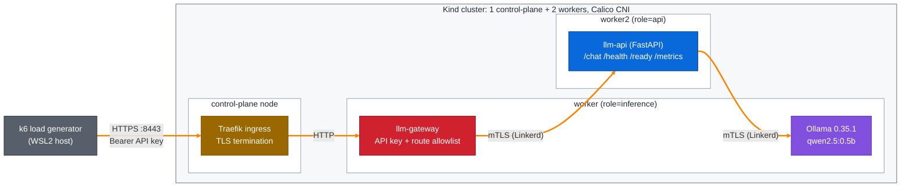

# Secure LLM Serving on Kubernetes

[](https://github.com/farrukhshafique87/secure-llm-serving-kubernetes/actions/workflows/ci.yml)
[](LICENSE)

Measures the latency and resource cost of RBAC, NetworkPolicies, Linkerd mTLS, TLS and an
API-key gateway for an LLM service (FastAPI + Ollama) on Kubernetes.

Built as part of my M.Sc. thesis in Information Technology at Frankfurt University of
Applied Sciences.

## Key findings (Kind, EXP-06 and EXP-02, 3 repetitions per configuration)

- With **all controls enabled**, the lightweight `/health` path became **+4.99 ms slower
  (+256.7 %)**: 6.94 ms instead of 1.95 ms on average.
- On the inference path `/chat` (about 2.1 s per request), **no control made requests
  measurably slower**: the differences stayed within run-to-run drift.
- On the `/health` path at 50 requests/s, the full security stack used **+279 millicores CPU
  and +264 MiB memory** across the pods in the request path. The gateway alone added the
  most CPU (+134 m), Linkerd the most memory (+115 MiB).

Under rising load (EXP-02, 50 to 200 requests/s) the per-request cost on `/health`
stayed about constant (median +3 ms for the gateway, +5.5 ms for all controls), but the
CPU-limited gateway left little headroom: from 70 requests/s single runs collapsed, while
the baseline handled every run up to 200 requests/s.
[`results/exp-02-load/load-summary.md`](results/exp-02-load/load-summary.md)

Full tables: [`results/exp-06-final/overhead-summary.md`](results/exp-06-final/overhead-summary.md).
Method: [`docs/research/experiment-methodology.md`](docs/research/experiment-methodology.md).

## Architecture

The diagram shows the fully secured configuration (C6). Each security control can also be
enabled on its own (see the table below).



In C6, every pod has its own ServiceAccount (RBAC) and a default-deny NetworkPolicy allows
only the connections shown by the arrows, plus DNS and the Linkerd control plane.

### Configurations measured

| ID | Overlay | Controls enabled | Entry point |
| --- | --- | --- | --- |
| C0 | `kind-baseline` | none (reference) | `http://localhost:8010` (NodePort) |
| C1 | `kind-c1-rbac` | RBAC: one ServiceAccount per workload | `http://localhost:8010` |
| C2 | `kind-c2-netpol` | NetworkPolicies: default deny + allow rules | `http://localhost:8010` |
| C3 | `kind-c3-mtls` | Linkerd mTLS between pods | `http://localhost:8010` |
| C4 | `kind-c4-tls` | TLS at the Traefik ingress | `https://localhost:8443` |
| C5 | `kind-c5-gateway` | API-key gateway with route allowlist | `http://localhost:8010` |
| C6 | `kind-secure` | all of the above | `https://localhost:8443` with API key |

All configurations share one Kustomize base. Each control is a Kustomize component, so an
overlay is just a list of components. The `llm-api` and `llm-gateway` containers run as a
non-root user (UID 10001) with all Linux capabilities dropped in every configuration,
including C0, so this hardening is not counted as overhead. The Ollama container runs with
the image defaults (no `securityContext`).

## Quick start (baseline C0)

Requirements: Docker Desktop (WSL2 backend on Windows), kind, kubectl, make, curl.
Run in WSL2 or another Linux shell. Versions used: see [Tech stack](#tech-stack).

```bash
git clone https://github.com/farrukhshafique87/secure-llm-serving-kubernetes.git && cd secure-llm-serving-kubernetes
make kind-up               # Kind cluster (1 control-plane + 2 workers) with Calico
make build load            # build llm-api:1.0.0 and load it into Kind
make deploy-baseline       # deploy C0
make pull-model-baseline   # pull qwen2.5:0.5b into Ollama
curl -s -X POST localhost:8010/chat -H 'Content-Type: application/json' -d '{"prompt":"Explain Kubernetes in one sentence."}'
```

Example response from my machine (CPU inference, 2.8 s):

```json
{"response":"Kubernetes is a popular open-source platform for managing and deploying containerized applications. It allows developers to easily scale, deploy, and manage applications in a scalable and fault-tolerant manner.","generated_tokens":39,"tokens_per_second":15.598}
```

Tested on 2026-10-15 from a fresh clone on an existing Kind cluster: `make kind-up` skipped
cluster creation, all other steps ran as shown. Cluster creation itself was not re-tested on
that day.

Secure configuration (C6, needs Helm): `make secrets ingress linkerd`, `make build-gateway load-gateway`,
`make deploy-secure`, `make pull-model-secure`. Only one environment should run at a time:
`make pause-baseline` before starting another one (`make help` lists all targets).
`make kind-down` deletes the whole cluster.

## Results (EXP-06)

Average latency with min-max over 3 repetitions. Δ is the difference to the baseline C0.
"Higher" or "lower" means the min-max range does not overlap with the baseline's;
otherwise the difference is "within noise".

### Lightweight path `/health` (no inference): cost of the controls per request

| Config | Avg ms | Δ ms | Δ % | P95 ms | P99 ms | Verdict |
| --- | --- | --- | --- | --- | --- | --- |
| C0 baseline | 1.95 (1.89-2.02) | - | - | 2.57 | 3.15 | reference |
| C1 RBAC | 1.97 (1.93-2.03) | +0.03 | +1.3 | 2.61 | 3.30 | within noise |
| C2 NetworkPolicies | 1.93 (1.88-2.01) | -0.01 | -0.6 | 2.55 | 3.23 | within noise |
| C3 mTLS | 2.31 (2.24-2.38) | +0.36 | +18.6 | 2.99 | 3.89 | higher |
| C4 TLS | 2.70 (2.65-2.76) | +0.75 | +38.6 | 3.37 | 4.29 | higher |
| C5 gateway | 4.36 (4.32-4.44) | +2.42 | +124.2 | 5.54 | 7.50 | higher |
| C6 all | 6.94 (6.34-8.07) | +4.99 | +256.7 | 8.93 | 11.82 | higher |

RBAC and NetworkPolicies add no measurable latency. The gateway is the most expensive single
control, because it adds a second HTTP hop.

### Inference path `/chat`: end-to-end latency including inference

| Config | Avg ms | Δ ms | Δ % | P95 ms | P99 ms | Verdict |
| --- | --- | --- | --- | --- | --- | --- |
| C0 baseline | 2146.38 (2021.21-2316.47) | - | - | 2422.84 | 2691.04 | reference |
| C1 RBAC | 2013.77 (1975.77-2088.69) | -132.62 | -6.2 | 2165.50 | 2242.65 | within noise |
| C2 NetworkPolicies | 2023.60 (1982.51-2074.37) | -122.78 | -5.7 | 2168.23 | 2263.48 | within noise |
| C3 mTLS | 1914.69 (1827.93-2004.16) | -231.70 | -10.8 | 2012.70 | 2121.53 | lower (drift) |
| C4 TLS | 2018.81 (1995.86-2062.44) | -127.57 | -5.9 | 2190.46 | 2358.17 | within noise |
| C5 gateway | 2059.76 (2025.81-2111.31) | -86.63 | -4.0 | 2303.58 | 3075.00 | within noise |
| C6 all | 1971.14 (1950.23-1985.36) | -175.25 | -8.2 | 2076.67 | 2169.27 | lower (drift) |

A configuration that is faster than the baseline cannot be a cost of the control: it shows
drift between runs. The milliseconds added by the controls are hidden by about 2 s of inference.

### Resources on the `/health` path (50 requests/s)

Mean CPU (millicores) and memory (MiB) of the pods in the request path.

| Config | Pods summed | CPU m | Δ CPU m | Memory MiB | Δ Memory MiB |
| --- | --- | --- | --- | --- | --- |
| C0 baseline | fastapi | 86 | - | 46 | - |
| C1 RBAC | fastapi | 86 | +0 | 45 | -1 |
| C2 NetworkPolicies | fastapi | 86 | -1 | 45 | -0 |
| C3 mTLS | fastapi + Linkerd control plane | 113 | +26 | 161 | +115 |
| C4 TLS | fastapi, traefik | 130 | +44 | 149 | +104 |
| C5 gateway | fastapi, gateway | 220 | +134 | 92 | +47 |
| C6 all | all of the above | 365 | +279 | 309 | +264 |

Source: [`results/exp-06-final/overhead-summary.md`](results/exp-06-final/overhead-summary.md).

## How it was measured

| Item | Setting |
| --- | --- |
| Load generator | k6 v2.0.0 on the WSL2 host |
| `/chat` | 1 virtual user, 5 minutes per run ([`tests/k6/baseline.js`](tests/k6/baseline.js)) |
| `/health` | constant 50 requests/s, 2 minutes per run ([`tests/k6/health-path.js`](tests/k6/health-path.js)) |
| Repetitions | 3 per configuration, configurations interleaved (C0, C1, ... C0, C1, ...) |
| Inference | qwen2.5:0.5b, temperature 0, seed 42, 64 output tokens, model kept loaded |
| Validity | a run counts only if no pod restarted during it |
| Run window | 2026-10-08 22:21 UTC to 2026-10-09 03:44 UTC |
| Host | Windows 11, WSL2, 8 CPU cores, 10 GiB memory for WSL |

Full protocol: [`docs/research/experiment-methodology.md`](docs/research/experiment-methodology.md).

## Security verification (EXP-05)

Before measuring, each control was tested with [`scripts/verify-controls.sh`](scripts/verify-controls.sh).

| Configuration | Checks passed | Examples |
| --- | --- | --- |
| C1 RBAC | 5 of 5 | API pod has no API token mounted; its ServiceAccount cannot list pods |
| C3 mTLS | 3 of 3 | Linkerd proxy in the API and Ollama pods; API to Ollama traffic is mTLS |
| C6 all | 12 of 12 | all of the above, plus: API cannot reach the internet, gateway cannot reach Ollama |
| C2 NetworkPolicies | 2 of 2 (re-run 2026-10-15) | API can reach Ollama; API cannot reach the internet |

Evidence: [`results/exp-05-security-verification/`](results/exp-05-security-verification/).

## Limitations

- **One local machine.** All results come from Kind on one WSL2 host. They do not
  automatically apply to a managed cloud cluster; the cloud comparison (EXP-07) is planned.
- **Three repetitions per configuration.** Enough to separate clear effects from noise, not
  for fine statistical claims.
- **Small model, CPU inference.** qwen2.5:0.5b on CPU. Larger models were not tested; slower
  inference would be expected to hide the controls' cost on `/chat` even more.
- **One replica per workload.** Scaling behaviour was not measured.
- **Self-signed certificate.** TLS uses a lab certificate, not one from a public CA.
- **Ollama runs without a `securityContext`.** Only the API and gateway containers are
  hardened (non-root, capabilities dropped).

## What I learned

- **Where you measure decides what you see.** All controls together added about 5 ms per
  request on `/health` (+257 %), but on `/chat` that cost disappeared behind about 2 s of
  inference. Without the lightweight path, my benchmark would have reported "no overhead".
- **Not every security control costs the same.** RBAC and NetworkPolicies made no
  measurable difference at request time. The real cost came from extra hops and extra
  processes: the API-key gateway added the most CPU (+134 m), Linkerd the most memory (+115 MiB).
- **A fair comparison needs controlled variables.** Fixed seed and temperature, images
  pinned by digest, fixed node placement, interleaved runs and three repetitions. A
  configuration that looked faster than the baseline showed me drift between runs, not a benefit.
- **A check must be able to fail, and it must keep its error.** One NetworkPolicy check
  failed without recording why, and I could not explain it afterwards. My verification
  script now waits for Ready pods and prints the error of every failed check.
- **Some Kubernetes resources are shared by the whole cluster.** A paused environment still
  held NodePort 30010, which made resuming another environment fail halfway. I added a guard
  that stops before `kubectl apply` when a port is already taken.

## Next steps

- Repeat the baseline-versus-secure comparison on a managed cloud cluster (EXP-07).
- Add a `securityContext` to the Ollama deployment (non-root, capabilities dropped) and
  measure whether it changes anything.
- Raise the gateway CPU limit and repeat the load levels (EXP-04), then test replicas (EXP-03).

## Tech stack

Versions as recorded in the environment file of the final run
([`results/exp-06-final/c6-all-environment.txt`](results/exp-06-final/c6-all-environment.txt)).
The Calico version is not in that file; it was read from the same Kind cluster on
2026-10-15 (`calico-node` image `quay.io/calico/node:v3.32.2`).

| Area | Tools |
| --- | --- |
| Application | Python 3.12, FastAPI 0.116.1, httpx, Prometheus client |
| LLM runtime | Ollama 0.35.1 (image pinned by digest), model qwen2.5:0.5b |
| Containers | Docker 29.6.2 |
| Kubernetes | Kind v0.23.0, Kubernetes v1.31.0, Calico v3.32.2 (tigera-operator v1.42.6), Kustomize v5.8.1 |
| Security | RBAC, NetworkPolicies, Linkerd edge-26.10.1 (mTLS), Traefik v3.7.13 (TLS), own FastAPI gateway |
| Installed with Helm v3.21.3 | Traefik (chart 41.6.1), Linkerd (chart 2026.10.1) |
| Observability | Prometheus v3.5.0, Grafana 12.1.1, metrics-server v0.9.0 |
| Load testing | k6 v2.0.0 |
| Quality | GitHub Actions CI, pytest, ruff, yamllint, kubeconform, pre-commit, gitleaks |

## Repository structure

```text
.
├── .github/workflows/   # CI: lint, tests, manifest validation, image build
├── apps/
│   ├── llm-api/         # FastAPI service in front of Ollama
│   └── llm-gateway/     # API-key gateway with route allowlist
├── docker/              # Docker Compose setup for local development
├── docs/                # research notes, methodology, traceability matrix
├── kind/                # Kind cluster, Calico and Traefik configuration
├── kubernetes/
│   ├── base/            # shared manifests (namespace, deployments, services, PVC)
│   ├── components/      # one Kustomize component per security control
│   └── overlays/        # C0-C6 configurations
├── monitoring/          # Prometheus and Grafana manifests
├── results/             # raw experiment output and summary tables
├── scripts/             # cluster setup, secrets, experiment runner, analysis
├── tests/k6/            # load test scripts
└── Makefile             # common commands (make help)
```

## Academic context

- **Thesis:** Secure Distributed Deployment and Performance Evaluation of Large Language Models on Kubernetes
- **Institution:** Frankfurt University of Applied Sciences
- **Degree:** Master of Science in Information Technology

## License

[MIT](LICENSE)
